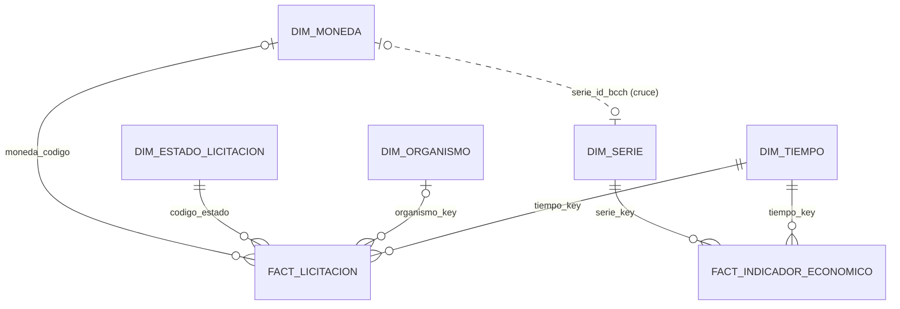

# Issue 2 · Modelo de datos en PostgreSQL: capas, modelo dimensional, idempotencia y auditoría

> **Responsable:** Gustavo (@Rhezm) · **Etiqueta:** `modelo-datos` · **Hito:** Base lista
> **Ramas:** `feature/2-modelo-datos` (**PR A**: el DDL, que es el **primer PR del proyecto**, el **sáb 24-10 en la mañana**) · `feature/2-diagrama-consultas` (**PR B**, el **mar 27-10**)
> **Revisan tus PR:** Ivan (@ivvan-asv) el PR A y Sofia (@Sofia-espinosa) el PR B
> **Depende de:** nada para el PR A, que pruebas con un contenedor suelto. El PR B usa datos cargados por las Issues 3 y 4.
> **Bloquea a:** Issue 1, que monta tu `01_modelo.sql` en Docker Compose, y a todas las demás.

Documentos de apoyo: [Plan](https://github.com/JAlbornozPIXX/Chilean-market-API-data/blob/main/planificacion/00_PLAN_DEL_PROYECTO.md) · [Glosario](https://github.com/JAlbornozPIXX/Chilean-market-API-data/blob/main/planificacion/01_GLOSARIO.md) · [Manual de GitHub](https://github.com/JAlbornozPIXX/Chilean-market-API-data/blob/main/planificacion/02_MANUAL_GITHUB.md) · [Guía de presentación y defensa](https://github.com/JAlbornozPIXX/Chilean-market-API-data/blob/main/planificacion/03_PRESENTACION_Y_DEFENSA.md)

---

## 1. Tu misión en una frase

Ser el dueño o la dueña de la **base de datos**:

- las **capas** `raw → staging → dw → mart`, más `audit`;
- el **modelo dimensional** (hechos, dimensiones, claves y tipos);
- la **idempotencia**: que re-ejecutar no duplique;
- la **tabla de auditoría**.

Además produces el **diagrama del modelo** y las **consultas SQL de evidencia** que usan el informe y la demo en vivo.

## 2. ¿Por qué es importante? (lo que pide la pauta)

| Criterio de la pauta | Qué depende de ti |
|---|---|
| **Modelo de datos en PostgreSQL** (5 pts): *"Capas raw, staging, dw y mart; modelo dimensional coherente (hechos, dimensiones, claves y tipos) y carga idempotente."* | Todo `01_modelo.sql` y saber explicarlo |
| Instrucción 4: *"al menos una tabla de hechos y dos dimensiones, incluyendo una dimensión de tiempo, con claves y tipos de datos definidos. Se entrega el DDL."* | Tenemos **2 hechos y 5 dimensiones**, incluida `dim_tiempo` |
| Instrucción 5: *"etl_audit con DAG, run_id, filas leídas y cargadas, % de nulos, duración y estado"* | La tabla `audit.etl_audit` |
| *"Información de carga (obtenida de la tabla de auditoría)"* | Tus consultas de evidencia y la revisión de la sección 7 del informe |
| Informe *"Destacado"*: *"evidencia completa (capturas de Airflow, logs, **consultas**)"* | El archivo `consultas_evidencia.sql`, que va en el Anexo A del informe |
| Indicador de evaluación del curso: *"Distingue los tipos de almacenamientos de los sistemas de información OLTP"* | Debes explicar la diferencia entre **OLTP** y **OLAP/Data Warehouse** (Paso 3) |

## 3. Conceptos que debes dominar

La explicación larga está en el [Glosario](https://github.com/JAlbornozPIXX/Chilean-market-API-data/blob/main/planificacion/01_GLOSARIO.md).

- **OLTP vs. OLAP:**
  - *OLTP* (procesamiento transaccional) es el sistema que **opera** el negocio: Mercado Público registra cada licitación con muchas escrituras pequeñas y rápidas, datos normalizados y el estado *actual*.
  - *OLAP* (procesamiento analítico) es el sistema que **analiza**: lecturas grandes, agregaciones, historia y modelos dimensionales.
  - Nuestro `dw` y nuestro `mart` son OLAP. La información la tomamos, vía API, del OLTP de ChileCompra.
- **Data Warehouse (DW):** base diseñada para análisis, que integra varias fuentes (aquí MP + BCCh) con historia. Un **Data Mart** es un subconjunto orientado a un tema o usuario; el nuestro es el de los KPIs.
- **Esquema:** "carpeta" dentro de una base de datos que agrupa tablas (`raw`, `staging`, `dw`, `mart`, `audit`).
- **Tabla de hechos:** registra **eventos medibles** con sus **medidas** numéricas (montos, días, valores).
- **Dimensión:** describe el contexto (*quién, cuándo, qué*) por el que se filtra y agrupa.
- **Grano:** qué representa **una fila** de un hecho. Es la decisión más importante del modelo.
- **Clave natural vs. subrogada:**
  - La *natural* viene del negocio (`codigo_organismo`).
  - La *subrogada* es un número interno generado por la base (`organismo_key SERIAL`), estable y compacto.
  - La **clave inteligente** `tiempo_key = yyyymmdd` es legible y se calcula desde la fecha.
- **Dimensión conformada:** la misma dimensión compartida por varios hechos (`dim_tiempo`). Permite cruzar fuentes.
- **Esquema estrella / constelación:**
  - *Estrella* = un hecho rodeado de dimensiones.
  - *Constelación* = varios hechos que comparten dimensiones. **El nuestro es una constelación.**
- **PK / FK / UNIQUE / índice:**
  - La clave primaria identifica cada fila; la foránea apunta a otra tabla.
  - `UNIQUE` impide valores repetidos.
  - El índice acelera las búsquedas.
- **Idempotencia:** ejecutar algo 1 o 10 veces deja **el mismo resultado**. En SQL se logra con `INSERT ... ON CONFLICT DO UPDATE` (*upsert*) o con `DELETE + INSERT` en una transacción.
- **Transacción:** grupo de operaciones que se aplican **todas o ninguna** (`COMMIT` / `ROLLBACK`).
- **JSONB:** tipo de PostgreSQL que guarda JSON en formato binario y se puede consultar (`payload->'Listado'`).

## 4. Archivos que te pertenecen

```
proyecto_etl/sql/ddl/01_modelo.sql                 (PR A)
proyecto_etl/sql/consultas/consultas_evidencia.sql (PR B, archivo nuevo)
proyecto_etl/docs/figuras/modelo_dimensional.png   (PR B, archivo nuevo)
```

**No toques:**

- `00_init_meta.sh`, que es de la Issue 1.
- Los `.py` de `dags/`.
- `kpis.sql`, que es de la Issue 5, aunque escribe en `mart`.

Si alguien necesita una columna nueva, la pide en esta issue y **tú** la agregas.

## 5. Paso a paso — PR A (el DDL)

### Paso 0 — Prepárate (Día 0: hoy, vie 23-10)

Instala Docker Desktop, Git y VS Code, y clona el repo con la carpeta `referencia/`. Sigue la Parte B del [Manual de GitHub](https://github.com/JAlbornozPIXX/Chilean-market-API-data/blob/main/planificacion/02_MANUAL_GITHUB.md). Pide tu ticket de Mercado Público y tu usuario del BCCh: los necesitarás para probar con datos reales en el PR B.

Opcional: instala **DBeaver** (https://dbeaver.io), un cliente gráfico de bases de datos. Te sirve para ver las tablas y generar diagramas.

### Paso 1 — Crea tu rama y copia el DDL

```bash
git switch main && git pull
git switch -c feature/2-modelo-datos
git push -u origin feature/2-modelo-datos
mkdir -p proyecto_etl/sql/ddl
cp referencia/proyecto_etl/sql/ddl/01_modelo.sql proyecto_etl/sql/ddl/
```

### Paso 2 — Entiende el DDL capa por capa

Ábrelo al lado de esta guía. Los números de línea son los del archivo de `referencia/`.

**Esquemas (líneas 8–12):** `CREATE SCHEMA IF NOT EXISTS raw | staging | dw | mart | audit`. El `IF NOT EXISTS` hace que el script se pueda ejecutar varias veces: es el primer nivel de idempotencia.

**RAW: los datos tal como llegan (líneas 14–48)**

| Tabla | Una fila es… | La escribe | Columnas clave |
|---|---|---|---|
| `raw.bcch_series` | la respuesta de la API del BCCh para **1 serie y 1 rango de fechas** | `bcch.extraer` | `payload JSONB`, `http_status`, `run_id`, `extraido_en` |
| `raw.mp_licitaciones_dia` | el **listado completo de 1 día** de Mercado Público | `mercadopublico.extraer` | `fecha_consulta`, `payload` |
| `raw.mp_licitacion_detalle` | el **detalle de 1 licitación** en una consulta | `mercadopublico.extraer` | `codigo_externo`, `payload` |

¿Por qué guardar el JSON crudo?

1. La pauta lo pide: *"guardar la respuesta tal como llega en el esquema raw ... junto con la fecha y hora de la extracción"*. Eso es `extraido_en TIMESTAMPTZ DEFAULT now()`.
2. Si cambia la transformación, se puede **re-procesar sin volver a llamar** a la API, lo que cuida la cuota del ticket.
3. Da trazabilidad y auditoría.

Raw es **solo de agregar filas** (*append-only*, con `raw_id BIGSERIAL`): cada extracción queda como historia. La idempotencia se garantiza en staging y dw.

**STAGING: limpio, tipado y deduplicado (líneas 50–82)**

| Tabla | Una fila es… | Clave primaria | Notas |
|---|---|---|---|
| `staging.bcch_observacion` | el valor de **1 serie en 1 fecha** | `(serie_id, fecha)` | `valor NUMERIC(18,4)`; `es_nulo` marca feriados y valores `NaN` |
| `staging.mp_licitacion` | **1 licitación**, en su última versión conocida | `codigo_externo` | `tiene_detalle` indica si ya se descargó el detalle; `fecha_consulta` es el **primer día en que apareció** (fecha de movimiento) |

Las claves primarias de staging son **claves naturales**: si llega otra vez la misma licitación o la misma serie y fecha, se **actualiza** en vez de duplicarse (`ON CONFLICT`).

**DW: el modelo dimensional (líneas 84–167)**

| Tabla | Tipo | Clave | Qué aporta |
|---|---|---|---|
| `dw.dim_tiempo` | Dimensión (**conformada**) | `tiempo_key INTEGER` = `yyyymmdd` (clave inteligente) | Fecha, año, trimestre, mes, nombre del mes, día, día de semana, fin de semana y `anio_mes`. La llena `asegurar_dim_tiempo()` de `common.py` con `generate_series` |
| `dw.dim_serie` | Dimensión | `serie_key SERIAL` (subrogada) + `serie_id UNIQUE` (natural) | Las 4 series del BCCh: nombre, unidad, moneda que convierte y frecuencia |
| `dw.dim_organismo` | Dimensión | `organismo_key SERIAL` + `codigo_organismo UNIQUE` | Organismo comprador y región. Se **sobrescribe** si cambia el nombre (SCD tipo 1: no guarda historia) |
| `dw.dim_estado_licitacion` | Dimensión (catálogo fijo) | `codigo_estado` | Estados de MP con las banderas `es_final` y `es_exitoso` que usan los KPIs. Se carga con `INSERT ... ON CONFLICT DO NOTHING` (líneas 123–127) |
| `dw.dim_moneda` | Dimensión (catálogo fijo) | `moneda_codigo` | CLP, USD, EUR, CLF (UF) y UTM con su `serie_id_bcch`: **el puente del cruce entre las dos fuentes** |
| `dw.fact_indicador_economico` | **Hecho 1** | PK compuesta `(tiempo_key, serie_key)` → **grano: serie × día** | Medidas: `valor` y `variacion_diaria_pct`. FK a `dim_tiempo` y `dim_serie` |
| `dw.fact_licitacion` | **Hecho 2** | PK `codigo_externo` → **grano: una licitación** | Medidas: monto original, monto en CLP, monto en UF, días de publicación y cantidad de ítems. FK a tiempo, organismo, estado y moneda. `organismo_key` y `moneda_codigo` aceptan NULL porque hay licitaciones sin detalle |

`tiempo_key` de `fact_licitacion` es la **fecha de movimiento**: el día en que la licitación apareció en el listado. Es un hallazgo del proyecto: el listado diario incluye licitaciones antiguas con movimiento. Si se usara la fecha de publicación, los KPIs mensuales quedarían dispersos en meses con 1 o 2 registros. La fecha de publicación se usa en cambio para elegir el tipo de cambio de la conversión.

**El diagrama (constelación de 2 hechos).** GitHub lo dibuja automáticamente:



**MART e índices (líneas 167–190)**

- `mart.kpi_mensual` tiene PK `(anio_mes, kpi_codigo)`: un valor por KPI y por mes.
- `mart.top_organismos_mes` tiene PK `(anio_mes, ranking)`.
- Ambas tablas las recalcula `kpis.sql` (Issue 5) con `DELETE + INSERT` en una sola transacción.
- Los índices `ix_fact_lic_tiempo` e `ix_audit_dag` aceleran los filtros por fecha y por DAG.

**AUDIT (líneas 192–212):** `audit.etl_audit` tiene una fila por tarea ejecutada. Así se corresponde con la pauta:

| La pauta pide | Columna |
|---|---|
| DAG | `dag_id` (y `task_id`) |
| run_id | `run_id` |
| filas leídas y cargadas | `filas_leidas`, `filas_cargadas` (y `filas_rechazadas`) |
| % de nulos | `pct_nulos` |
| duración | `inicio`, `fin`, `duracion_seg` |
| estado | `estado` (SUCCESS / RETRY / FAILED) |
| *(extra)* | `intento` y `mensaje` (el error) |

**¿Por qué estos tipos de datos?**

| Tipo | Dónde | Por qué |
|---|---|---|
| `NUMERIC(p,s)` | montos y valores | Decimal **exacto**. Con `float`, 0,1 + 0,2 no da exactamente 0,3; con plata eso no se acepta |
| `TIMESTAMPTZ` | `extraido_en`, `inicio`, `fin` | Guarda un **instante** con zona horaria: Airflow trabaja en UTC y la UI muestra la hora de Chile |
| `TIMESTAMP` | `fecha_cierre`, `fecha_adjudicacion` | Fecha y hora "locales", tal como las publica MP |
| `DATE` | fechas sin hora | Ahorra espacio y evita confusiones de horario |
| `JSONB` | `payload` | JSON consultable y comprimido |
| `SERIAL` / `BIGSERIAL` | claves subrogadas / `raw_id` | Números autoincrementales. `BIG` para raw, que crece mucho |
| `SMALLINT`, `BOOLEAN`, `CHAR(7)` | dimensión de tiempo | Tamaños justos (`anio_mes` siempre mide 7: `2026-10`) |

**¿Dónde se garantiza la idempotencia?** Debes saber esta tabla de memoria:

| Capa | Mecanismo | Dónde |
|---|---|---|
| DDL | `CREATE ... IF NOT EXISTS`; datos semilla con `ON CONFLICT DO NOTHING` | `01_modelo.sql` |
| raw | Se agregan filas **a propósito**: es la bitácora de extracciones | `extraer()` |
| staging | `INSERT ... ON CONFLICT (clave natural) DO UPDATE` | `transformar()` |
| dimensiones | `ON CONFLICT DO UPDATE` / `DO NOTHING` | `cargar_dw()`, `asegurar_dim_tiempo()` |
| hechos | `ON CONFLICT (PK) DO UPDATE` | `cargar_dw()` |
| mart | `DELETE + INSERT` en una transacción | `kpis.sql` |

### Paso 3 — OLTP vs. OLAP, aplicado a nuestro caso

Escríbelo con tus palabras: te lo van a preguntar.

| | OLTP (Mercado Público, el sistema de ChileCompra) | OLAP / DW (nuestro `dw` y `mart`) |
|---|---|---|
| Para qué | Operar: publicar, ofertar, adjudicar | Analizar: medir eficiencia, transparencia, montos |
| Operaciones | Muchas escrituras pequeñas y concurrentes | Lecturas grandes con agregaciones (`GROUP BY`) |
| Modelo | Normalizado, para no repetir datos | Dimensional (hechos y dimensiones), pensado para consultar fácil |
| Datos | El estado actual | Historia e integración de fuentes (MP + BCCh) |
| Ejemplo en el proyecto | El JSON que entrega la API | `fact_licitacion` + `dim_tiempo` → `mart.kpi_mensual` |

### Paso 4 — Prueba el DDL de forma aislada, sin esperar a la Issue 1

Usa un contenedor PostgreSQL suelto. No necesitas `docker-compose.yml` ni abrir puertos.

```bash
docker run -d --name pg_prueba -e POSTGRES_USER=etl -e POSTGRES_PASSWORD=prueba -e POSTGRES_DB=dw_gestion postgres:16
until docker exec pg_prueba pg_isready -U etl -d dw_gestion; do sleep 1; done; sleep 3

# 1ª ejecución
docker exec -i pg_prueba psql -U etl -d dw_gestion -v ON_ERROR_STOP=1 < proyecto_etl/sql/ddl/01_modelo.sql && echo "1ª ejecución OK"
# 2ª ejecución: debe funcionar igual (idempotencia). Verás avisos "already exists, skipping": es normal
docker exec -i pg_prueba psql -U etl -d dw_gestion -v ON_ERROR_STOP=1 < proyecto_etl/sql/ddl/01_modelo.sql && echo "2ª ejecución OK"

docker exec pg_prueba psql -U etl -d dw_gestion -c "\dn" -c "\dt dw.*" -c "SELECT * FROM dw.dim_moneda" -c "SELECT count(*) FROM dw.dim_estado_licitacion"
```

Debes ver lo siguiente:

- 5 esquemas propios más `public`.
- 7 tablas en `dw`.
- 5 monedas en `dim_moneda`.
- 7 estados en `dim_estado_licitacion` (incluido `-1 Desconocido`).

> **Por qué importa `ON_ERROR_STOP`:** Docker Compose ejecuta este script al crear la base **con** esa opción. Un solo error detiene la inicialización y Postgres no arranca. Por eso lo pruebas dos veces seguidas.

### Paso 5 — Mejora del PR A: diccionario de datos y rol de solo lectura

Agrega al **final** de `01_modelo.sql` el bloque ya probado que está en el repositorio:

```bash
cat planificacion/recursos/mejoras_01_modelo.sql >> proyecto_etl/sql/ddl/01_modelo.sql
```

El bloque trae dos cosas:

1. **`COMMENT ON SCHEMA/TABLE/COLUMN`, el diccionario de datos.**
   - Documenta dentro de la base el grano de cada hecho, el tipo de clave y el significado de las columnas críticas.
   - Se ve en DBeaver y pgAdmin, y con `\dt+` en psql.
   - Es idempotente: reemplaza el comentario anterior.
   - Responde a *"claves y tipos definidos"* y a la *"Estrategia de datos: origen de los datos"*.
2. **El rol `analista_kpi` (solo lectura):**
   - Puede leer `dw` y `mart`, pero **no `raw`**, porque `raw` guarda el JSON completo del detalle, que incluye **datos personales** del funcionario comprador.
   - Es la respuesta concreta al riesgo *"datos personales o sensibles"* de la pauta.
   - El bloque `DO $$ ... IF NOT EXISTS ... $$` lo hace idempotente: PostgreSQL no tiene `CREATE ROLE IF NOT EXISTS`.

Vuelve a probar dos veces y revisa el resultado:

```bash
docker exec -i pg_prueba psql -U etl -d dw_gestion -v ON_ERROR_STOP=1 < proyecto_etl/sql/ddl/01_modelo.sql && echo OK
docker exec -i pg_prueba psql -U etl -d dw_gestion -v ON_ERROR_STOP=1 < proyecto_etl/sql/ddl/01_modelo.sql && echo OK
docker exec pg_prueba psql -U etl -d dw_gestion -c "\dt+ dw.*" \
  -c "SELECT has_schema_privilege('analista_kpi','raw','USAGE') AS ve_raw, has_schema_privilege('analista_kpi','mart','USAGE') AS ve_mart"
#   esperado: la columna Description con los comentarios; ve_raw = f, ve_mart = t
docker rm -f pg_prueba
```

### Paso 6 — Commit y PR A (¡el primero del proyecto!)

```bash
git add proyecto_etl/sql/ddl/01_modelo.sql
git commit -m "feat(modelo): DDL por capas, modelo dimensional, auditoría y diccionario de datos (#2)"
git push
```

Abre el PR con `Closes #2` **solo si ya terminaste también el PR B**. Si no, escribe `Parte de #2`, para que la issue no se cierre antes de tiempo. Pide revisión a Ivan y **avisa al grupo apenas se haga merge**: Ivan lo necesita para levantar Docker Compose.

## 6. Paso a paso — PR B (diagrama y consultas de evidencia)

### Paso 7 — Rama nueva desde `main` actualizado

```bash
git switch main && git pull
git switch -c feature/2-diagrama-consultas
git push -u origin feature/2-diagrama-consultas
```

### Paso 8 — Diagrama del modelo en PNG (para el informe y la lámina 5)

1. Abre https://mermaid.live y pega el contenido de `planificacion/recursos/modelo_dimensional.mmd`. Es el diagrama completo, con todas las columnas.
2. Revisa que se vea bien. Si quieres, ajusta el tema.
3. Descárgalo como PNG (menú *Actions* → *PNG*) y guárdalo en `proyecto_etl/docs/figuras/modelo_dimensional.png`, con ese nombre exacto: el generador del informe lo busca así.

*Alternativa:* en DBeaver, conéctate a la base (localhost:5433), abre el esquema `dw` → pestaña *ER Diagram* → exportar imagen.

### Paso 9 — Consultas de evidencia

```bash
mkdir -p proyecto_etl/sql/consultas
cp planificacion/recursos/consultas_evidencia.sql proyecto_etl/sql/consultas/
```

El archivo tiene 13 bloques, ya probados en PostgreSQL 16. Debes saber para qué sirve cada uno, porque son tu evidencia en la defensa:

| # | Consulta | Para qué |
|---|---|---|
| 1 | Registros por tabla | *"Cantidad de registros cargados por tabla"* (pauta) |
| 2 | Conteos de staging, dw y raw | **Prueba de idempotencia**: se ejecuta antes y después de un *Clear* |
| 3 | Últimas 15 tareas auditadas | Mostrar la auditoría en vivo |
| 4 | Fallas y reintentos | Evidencia de la demo de falla (filas RETRY/FAILED) |
| 5 | Registros por DAG y estado | Resumen de la auditoría |
| 6 | Tiempo de procesamiento por DAG | *"Tiempo de ejecución de cada DAG"* (pauta) |
| 7 | % de nulos en campos clave | *"Porcentaje de registros con errores o nulos"* (pauta) |
| 8 | Cobertura del detalle | Cuánto detalle permitió la cuota del ticket |
| 9 | Montos convertidos por moneda | Evidencia del **cruce** MP + BCCh |
| 10 | Rango y nulos por serie del BCCh | Verificar la recarga histórica |
| 11 | Top 5 licitaciones en UF | Ejemplo concreto del cruce |
| 12 | KPIs del último mes | Resultados de los indicadores |
| 13 | Frescura por fuente | Cuándo se cargó cada fuente por última vez |

Pruébalas cuando tengas datos: necesitas `main` con las Issues 1, 3 y 4, tu `.env` con credenciales, y haber dejado correr los DAGs.

```bash
cd proyecto_etl
docker compose exec -T postgres psql -U etl -d dw_gestion < sql/consultas/consultas_evidencia.sql
```

### Paso 10 — Commit y PR B

```bash
cd ..
git add proyecto_etl/sql/consultas/consultas_evidencia.sql proyecto_etl/docs/figuras/modelo_dimensional.png
git commit -m "docs(modelo): diagrama dimensional y consultas SQL de evidencia (#2)"
git push
```

Abre el PR con `Closes #2` y pide revisión a Sofia, que usa ambos archivos en el informe.

### Paso 11 — Fase 3 (jue 29-10): prueba de idempotencia en la máquina de demo

Hazla junto a Jairo:

1. Ejecuta la consulta 2 y anota los números.
2. En Airflow, abre un run **ya exitoso** del DAG de Mercado Público → *Clear* → espera a que vuelva a quedar verde.
3. Ejecuta de nuevo la consulta 2. Los conteos de **staging y dw no cambian**; `raw_listados_mp` sí sube, porque raw guarda cada extracción.
4. Publica el resultado ("antes / después") como **comentario en la Issue 5**: es evidencia para el informe.

Revisa también la **sección 7 del PDF** (Información de carga). Compara sus números con tus consultas 1, 5, 6 y 7 y reporta cualquier diferencia en la Issue 5.

## 7. Criterios de aceptación (Definition of Done)

- [ ] `01_modelo.sql` corre **dos veces seguidas** sin errores con `ON_ERROR_STOP=1`
- [ ] Existen los 5 esquemas, las 7 tablas de `dw`, las 2 de `mart` y `audit.etl_audit`
- [ ] Los comentarios (diccionario de datos) aparecen con `\dt+ dw.*`
- [ ] `analista_kpi` ve `mart` y no ve `raw`
- [ ] `modelo_dimensional.png` está en `docs/figuras/`, se lee bien y tiene el nombre exacto
- [ ] `consultas_evidencia.sql` corre completo sobre datos reales
- [ ] La prueba de idempotencia está documentada en la Issue 5
- [ ] Puedo explicar el grano de cada hecho, cada tipo de clave, OLTP vs. OLAP y la tabla de idempotencia

## 8. Tu parte en el informe y en la presentación

- **Informe:** revisas la sección 3.3 (Carga y modelo de datos) y la sección 7 (Información de carga). Envías tus correcciones como comentarios en la Issue 5.
- **Presentación:**
  - **Lámina 5 "Modelo de datos"** (~50 s): capas, diagrama, grano e idempotencia. Si te piden más, muestras en vivo la consulta 2 o la 9.
  - **Lámina 7 "Hallazgos de la carga"** (~30 s).

## 9. Preguntas probables en la defensa (con respuesta guía)

1. **¿Cuál es la diferencia entre OLTP y OLAP, y dónde está cada una en su proyecto?** Ver la tabla del Paso 3. El OLTP es el sistema de ChileCompra; nosotros construimos un almacenamiento OLAP (dw/mart) para análisis.
2. **¿Para qué sirve cada capa?**
   - **raw:** evidencia y re-proceso, guarda el JSON tal cual con su fecha y hora.
   - **staging:** limpio, tipado y deduplicado.
   - **dw:** el modelo dimensional integrado.
   - **mart:** los KPIs listos para consumir.
   - **audit:** la bitácora del proceso.
3. **¿Cuál es el grano de `fact_licitacion`?** Una fila por licitación (`codigo_externo`). Si la licitación cambia de estado, la fila se **actualiza** (upsert); no se agrega otra.
4. **¿Y el de `fact_indicador_economico`?** Una fila por serie del BCCh y por día. Su clave primaria es compuesta: `(tiempo_key, serie_key)`.
5. **¿Por qué es una constelación y no una estrella?** Porque hay **dos** tablas de hechos que comparten la dimensión de tiempo y se conectan por la moneda. Eso permite cruzar las dos fuentes.
6. **¿Por qué `tiempo_key` es un número tipo 20261015?** Es una clave inteligente: legible, ordenable, se calcula desde la fecha sin buscarla en la tabla, y además es compacta (INTEGER).
7. **¿Por qué `dim_organismo` tiene una clave subrogada si ya existe `codigo_organismo`?** La clave subrogada (SERIAL) es interna, compacta y estable, y no depende de cómo codifique la fuente. La natural se mantiene como `UNIQUE` para el upsert.
8. **¿Qué es una dimensión conformada?** Una dimensión que comparten varios hechos con el mismo significado. Aquí es `dim_tiempo`, la base del cruce temporal entre MP y BCCh.
9. **¿Cómo garantizan que re-ejecutar no duplique?** Con la tabla de idempotencia del Paso 2: `IF NOT EXISTS`, `ON CONFLICT ... DO UPDATE/NOTHING` sobre claves naturales o primarias, y `DELETE + INSERT` transaccional en el mart. Lo verificamos con la consulta 2 antes y después de un *Clear*.
10. **¿Entonces raw sí se duplica?** Crece a propósito: cada extracción es un registro histórico con su `extraido_en`. Los duplicados se eliminan al pasar a staging (`DISTINCT ON` y diccionarios por clave) y las claves de staging y dw impiden repetir.
11. **¿Por qué `organismo_key` y `moneda_codigo` aceptan NULL?** Porque el listado diario no trae el organismo ni la moneda: vienen en el detalle, que está limitado por la cuota. La licitación se carga igual y se completa cuando llega su detalle.
12. **¿Por qué NUMERIC y no FLOAT para los montos?** NUMERIC es exacto en base 10; FLOAT es aproximado. Para montos de dinero se necesita exactitud.
13. **¿Qué diferencia hay entre `DO UPDATE` y `DO NOTHING`?** Ante una clave repetida, `DO UPDATE` actualiza la fila existente con los valores nuevos (`EXCLUDED.*`) y `DO NOTHING` la deja como estaba. Los catálogos fijos usan `DO NOTHING`; los datos que cambian, `DO UPDATE`.
14. **¿Por qué el mart se recalcula con DELETE + INSERT?** Es simple y siempre consistente: el mart es pequeño y se recalcula entero. Al hacerlo en **una transacción**, quien lee nunca ve el mart vacío a medias.
15. **¿Cómo protegen los datos personales?** No pasan a staging ni a dw (minimización, Ley 19.628/21.719). Quedan solo en raw, y el rol `analista_kpi` no tiene acceso a raw.
16. **¿Qué es un índice y por qué crearon `ix_fact_lic_tiempo`?** Es una estructura que acelera búsquedas. Los KPIs agrupan y filtran por tiempo, así que el índice por `tiempo_key` evita recorrer toda la tabla.

## 10. Si te atascas

| Síntoma | Causa probable | Solución |
|---|---|---|
| `psql: error: connection to server ... failed` justo después de `docker run` | Postgres todavía está inicializando | Repite el `until ... pg_isready` y espera 3 s más |
| `ERROR: syntax error at or near "$$"` | El bloque `DO $$ ... $$` quedó mal copiado | Vuelve a copiar `mejoras_01_modelo.sql` completo (`cat ... >>`) desde el original del DDL |
| La 2ª ejecución falla con `already exists` como **ERROR** (no como NOTICE) | Falta un `IF NOT EXISTS` o un `ON CONFLICT` | Compáralo con el archivo de `referencia/` |
| mermaid.live marca un error | Copia incompleta | Copia el `.mmd` completo, desde `erDiagram` |
| En Git Bash (Windows): `the input device is not a TTY` | Usaste `-it` con un `<` | Con `<` usa solo `-i` (como en esta guía) o trabaja en WSL/Ubuntu |
| La consulta 9 muestra `convertidas_uf = 0` | Mercado Público cargó antes que el BCCh | En Airflow: DAG MP → último run → tarea `cargar_dw` → *Clear* (con *Downstream*). Ver Issue 4 |

Si después de 30 minutos sigues bloqueado, comenta en esta issue con el error exacto y etiqueta `bloqueante`.
